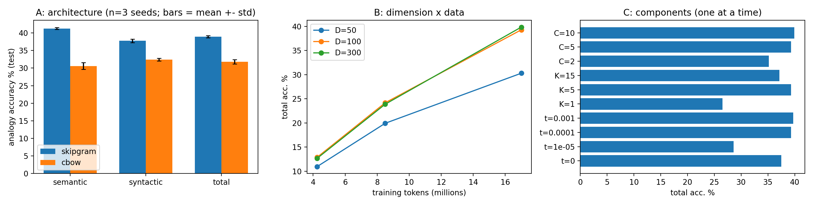
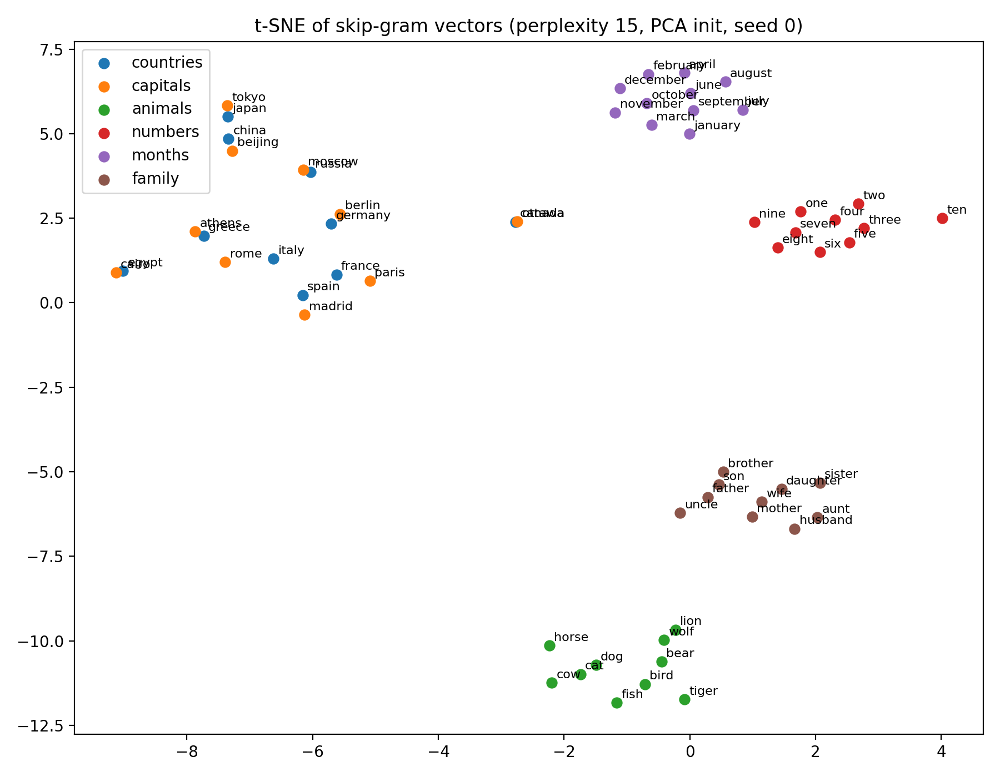
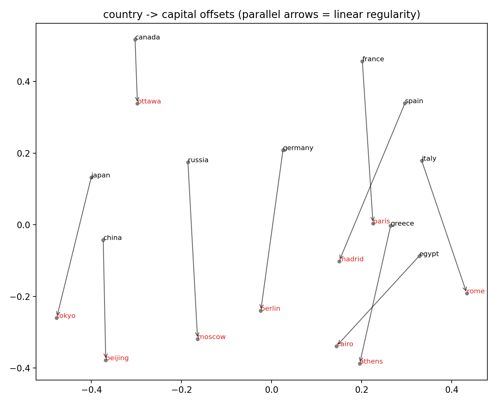

# 🧠 Word2Vec from Scratch: PyTorch Implementation

[](https://www.python.org/)
[](https://pytorch.org/)
[](https://opensource.org/licenses/MIT)
[]()
[]()

A complete, clean, and educational re-implementation of the classic **Word2Vec** paper (*"Efficient Estimation of Word Representations in Vector Space"* by Mikolov et al., 2013) built entirely from scratch using **PyTorch**.

This repository contains full implementations of both **Continuous Bag-of-Words (CBOW)** and **Skip-Gram with Negative Sampling (SGNS)**, trained on the ~17 million token `text8` Wikipedia corpus, along with comprehensive ablation studies, visualizations, and benchmark evaluations.

---

## 📖 Table of Contents
1. [What is Word2Vec? (In Simple Words)](#-what-is-word2vec-in-simple-words)
2. [The Two Core Architectures](#-the-two-core-architectures)
3. [Key Highlights & Engineering Design](#-key-highlights--engineering-design)
4. [Visualizations & Qualitative Insights](#-visualizations--qualitative-insights)
5. [Benchmark Results & Ablation Studies](#-benchmark-results--ablation-studies)
6. [Repository Structure](#-repository-structure)
7. [How to Run & Reproduce](#-how-to-run--reproduce)
8. [Authors & Academic Context](#-authors--academic-context)

---

## 💡 What is Word2Vec? (In Simple Words)

Computers only understand numbers, not words. If we just assign each word a random ID (like `cat = 1, dog = 2`), the computer has no idea that a *cat* and a *dog* are both furry pets, or that *king* relates to *queen* in the same way *man* relates to *woman*.

**Word2Vec solves this by converting words into continuous vectors (lists of numbers) in a multi-dimensional space:**
* Words that appear in similar contexts end up close together.
* Relationships between words become geometric directions:
  $$\vec{v}_{\text{King}} - \vec{v}_{\text{Man}} + \vec{v}_{\text{Woman}} \approx \vec{v}_{\text{Queen}}$$
  $$\vec{v}_{\text{Paris}} - \vec{v}_{\text{France}} + \vec{v}_{\text{Italy}} \approx \vec{v}_{\text{Rome}}$$

---

## 🏗 The Two Core Architectures

| Architecture | How It Works | Best For | Analogy |
| :--- | :--- | :--- | :--- |
| **Continuous Bag-of-Words (CBOW)** | Takes several context words and predicts the missing center target word. | Faster training; slightly higher semantic similarity on WordSim-353. | *Fill-in-the-blank*: "The ___ sat on the mat." $\to$ predicts **cat**. |
| **Skip-Gram (SGNS)** | Takes a single center word and predicts which words appear around it. | Better accuracy on semantic analogy questions and rare words. | *Brainstorming surroundings*: given **cat**, predicts **the**, **sat**, **mat**. |

```
        CBOW Architecture                         Skip-gram Architecture
  [Context: "the", "cat", "on"]                     [Target: "sat"]
               │                                           │
         (Vector Sum)                              (Input Embedding)
               │                                           │
       [Predict Target]                           [Predict Context]
         "sat" (Center)                        "the", "cat", "on", "mat"
```

### Why Negative Sampling?
Instead of calculating the probability across the entire dictionary (71,000+ words) every step with a costly softmax, **Negative Sampling** turns the problem into simple binary classification:
1. Maximize the probability of the true word pair (positive example).
2. Minimize the probability of $K$ random noise words (negative examples).

---

## ✨ Key Highlights & Engineering Design

- **100% From Scratch**: No high-level wrappers (like Gensim or HuggingFace). Built directly using PyTorch tensors and embedding layers.
- **On-GPU Batch Generation**: Sliding dynamic context windows ($R \sim \mathcal{U}\{1, \dots, C\}$) and frequent-word subsampling are computed efficiently on GPU.
- **SparseAdam Optimization**: Using PyTorch's sparse embeddings ensures only the words present in the active mini-batch receive gradient updates, reducing computational complexity to $\mathcal{O}(B \cdot K \cdot D)$.
- **Strict Dev/Test Isolation**: 20% validation split was used exclusively for hyperparameter tuning; all reported benchmarks reflect untouched test evaluation.

---

## 📊 Visualizations & Qualitative Insights

All figures below were generated directly from training on the `text8` dataset:

### 1. Controlled Experimental Results & Ablations
Comprehensive evaluation covering (Left) CBOW vs. Skip-gram across multiple random seeds, (Center) Embedding dimension vs. training tokens scaling, and (Right) One-factor-at-a-time ablation on subsampling $t$, negatives $K$, and window size $C$.



---

### 2. Semantic Clustering (t-SNE Projection)
A 2D t-SNE projection of 100-dimensional Skip-gram embeddings for six distinct conceptual groups:
* **Countries & Capitals** naturally align into neighboring, cohesive groups.
* **Numbers**, **Months**, **Animals**, and **Family terms** occupy clear, dedicated semantic clusters.



---

### 3. Linear Relationship Offsets (PCA Space)
Visualizing country-to-capital vectors in PCA space. The parallel offset arrows confirm the linear regularity:
$$\vec{v}_{\text{Capital}} - \vec{v}_{\text{Country}} \approx \text{constant}$$



---

## 📈 Benchmark Results & Ablation Studies

### Table 1: CBOW vs. Skip-Gram Comparison (Test Split, 3 Seeds)
*Base settings: $D=100$, $C=5$, $K=5$, $t=10^{-4}$, 3 epochs.*

| Model | Semantic % | Syntactic % | Total Analogy % | WordSim-353 $\rho$ | Training Time |
| :--- | :---: | :---: | :---: | :---: | :---: |
| **Skip-gram** | **41.3%** | **37.8%** | **38.9% ($\pm$ 0.3)** | 0.694 | ~91 s |
| **CBOW** | 30.6% | 32.4% | 31.8% ($\pm$ 0.6) | **0.703** | **~75 s** |
| **CBOW (9 epochs)** | 38.5% | 38.2% | 38.3% | 0.693 | 225 s |

> **Takeaway**: Skip-gram outperforms CBOW on semantic analogies, while CBOW is faster and excels at cosine ranking (WordSim-353). When trained for 9 epochs to match the number of gradient updates, CBOW closes the gap.

---

### Table 2: Embedding Dimension $\times$ Corpus Size Interaction
*Total analogy accuracy (%) across data fractions and vector dimensions:*

| Dimension ($D$) | 4.3M Tokens (25%) | 8.5M Tokens (50%) | 17.0M Tokens (100%) |
| :---: | :---: | :---: | :---: |
| **$D = 50$** | 10.95% | 19.92% | 30.30% |
| **$D = 100$** | **12.88%** | **24.17%** | **39.29%** |
| **$D = 300$** | 12.66% | 23.87% | **39.85%** |

> **Takeaway**: Increasing vector dimension without sufficient data yields diminishing returns. Moving from $D=50$ to $D=100$ provides a massive **+9.0%** gain, while moving from $D=100$ to $D=300$ yields only **+0.6%** on 17M tokens.

---

### Table 3: Component Ablations
*Single-factor variations evaluated on Skip-gram:*

| Component | Tested Value | Total Analogy % | WordSim-353 $\rho$ | Observation |
| :--- | :---: | :---: | :---: | :--- |
| **Subsampling ($t$)** | $0$ (Off)<br>$10^{-5}$<br>**$10^{-4}$ (Base)**<br>$10^{-3}$ | 37.50%<br>28.61%<br>**39.29%**<br>**39.69%** | 0.678<br>0.683<br>**0.688**<br>0.684 | Moderate subsampling ($10^{-3} - 10^{-4}$) discards redundant stop words and improves vector quality. $10^{-5}$ is too aggressive. |
| **Negatives ($K$)** | $1$<br>**$5$ (Base)**<br>$15$ | 26.54%<br>**39.29%**<br>37.14% | 0.673<br>**0.688**<br>0.641 | $K=1$ severely under-trains negative weights. $K=5$ is optimal for small-medium corpora. |
| **Window Radius ($C$)** | $2$<br>**$5$ (Base)**<br>$10$ | 35.14%<br>39.29%<br>**39.89%** | 0.659<br>0.688<br>**0.695** | Wider context windows capture broader topical semantics; narrow windows focus strictly on syntax. |

---

### Qualitative Verification: Nearest Neighbors & Analogy Probes

**Nearest Neighbors (Cosine Similarity):**
* `france` $\to$ paris, europe, italy, belgium, spain, germany
* `king` $\to$ queen, prince, throne, monarch, emperor, lord
* `computer` $\to$ computers, software, hardware, network, system
* `quickly` $\to$ rapidly, immediately, swiftly, suddenly, slowly

**Zero-Shot Analogy Probes ($\vec{x} = \vec{v}_b - \vec{v}_a + \vec{v}_c$):**
* `france : paris :: italy : ?` $\to$ **rome** ✅
* `big : bigger :: small : ?` $\to$ **smaller** ✅
* `man : woman :: king : ?` $\to$ **queen** ✅
* `walk : walking :: swim : ?` $\to$ **swimming** ✅
* `good : better :: bad : ?` $\to$ **worse** ✅

---

## 📁 Repository Structure

```text
├── README.md                      # Project documentation and findings
├── word2vec_V5_executed.ipynb     # Fully executed Jupyter notebook with outputs
├── results.csv                    # Raw benchmark scores across all configurations
├── gen_ieee_report.py             # Script to generate IEEE two-column camera-ready PDF
├── ieee_final_report_word2vec.pdf # Formatted IEEE 4-page academic report
│
├── executed_ipynb/                # Executed notebook archive
│   └── word2vec_V5 ex.ipynb
│
├── figures/                       # Benchmark charts & vector space projections
│   ├── ablations.png
│   ├── tsne.png
│   └── pca_offsets.png
│
├── ipynb/                         # Development & experiment notebooks
│   ├── word2vec_V5.ipynb
│   ├── word2vec_V4.ipynb
│   ├── word2vec_demoCX.ipynb
│   └── word2vec_V4 updated.ipynb
│
├── results/                       # Detailed experimental outputs & hyperparameters
│   ├── results.csv
│   ├── results_full.json
│   └── lr_choice.json
│
└── files/                         # Papers, presentations, and templates
    ├── 1301.3781v3.pdf            # Original Mikolov et al. (2013) paper
    ├── word2vec_presentation_24CS2037.pptx
    └── word2vec_report_24CS2037.pdf
```

---

## 🚀 How to Run & Reproduce

### 1. Requirements
Ensure you have Python 3.8+ and PyTorch installed:
```bash
pip install torch numpy scipy matplotlib tqdm reportlab Pillow
```

### 2. Run the Interactive Notebook
Open and run [`word2vec_V5_executed.ipynb`](./word2vec_V5_executed.ipynb) in Jupyter Lab, Jupyter Notebook, or Google Colab:
```bash
jupyter notebook word2vec_V5_executed.ipynb
```

The notebook automatically:
1. Downloads the `text8` corpus.
2. Preprocesses text, builds the vocabulary, and sets up subsampling.
3. Trains both CBOW and Skip-gram with PyTorch.
4. Runs analogy evaluation and WordSim-353 correlation tests.
5. Saves all ablation figures and `results.csv`.

### 3. Generate the IEEE PDF Report
To generate the formatted 4-page IEEE publication report:
```bash
python gen_ieee_report.py
```
This produces [`ieee_final_report_word2vec.pdf`](./ieee_final_report_word2vec.pdf).

---

## 🎓 Authors & Academic Context

* **Author**: Sudipto Ghosh
* **Roll No.**: 24CS2037
* **Paper ID**: DL-041
* **Course**: Deep Learning (2026)
* **Department**: Department of Computer Science and Engineering

### References
1. Tomas Mikolov, Kai Chen, Greg Corrado, and Jeffrey Dean. *"Efficient Estimation of Word Representations in Vector Space."* ICLR Workshop, 2013. [arXiv:1301.3781](https://arxiv.org/abs/1301.3781).
2. Tomas Mikolov, Ilya Sutskever, Kai Chen, Greg Corrado, and Jeffrey Dean. *"Distributed Representations of Words and Phrases and their Compositionality."* NeurIPS, 2013.
3. Lev Finkelstein et al. *"Placing Search in Context: The Concept Based Information Retrieval."* ACM TOIS, 2002.
